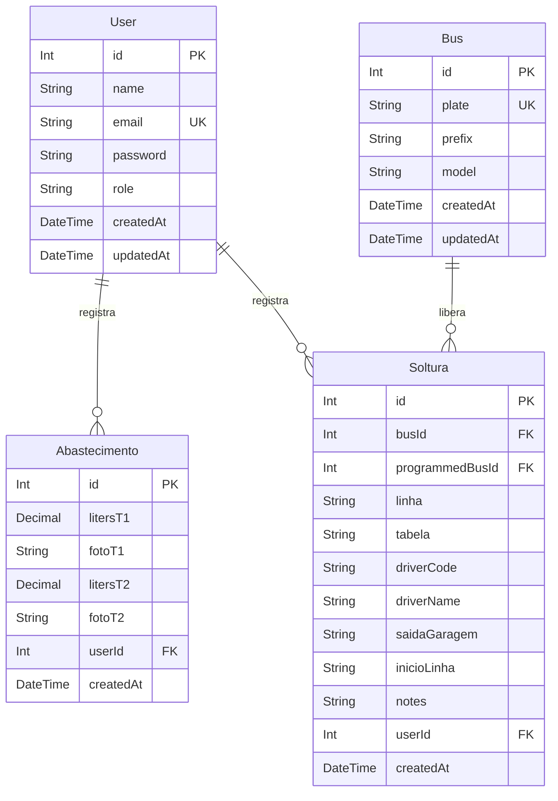

# Documentação do Projeto: Sistema Garagem

Este documento fornece uma análise detalhada e abrangente do **Sistema Garagem**, um sistema desenvolvido para gerenciamento interno de operações de garagem de ônibus, focado no registro e controle de **abastecimentos** e **solturas** (despacho) de veículos.

---

## 1. Visão Geral e Arquitetura

O projeto está estruturado como um **Monorepo** utilizando **NPM Workspaces**. Ele é dividido em duas aplicações principais localizadas no diretório `apps/`:

1. **`apps/api` (Backend)**: Uma API REST desenvolvida em **Node.js** com **Express** e **TypeScript**, utilizando **Prisma ORM** para comunicação com um banco de dados **PostgreSQL**.
2. **`apps/web` (Frontend)**: Uma aplicação Single Page Application (SPA) moderna em **React** construída com **Vite**, **TypeScript**, estilizada com **Tailwind CSS** e componentes do **Radix UI**, com gerenciamento de estado via **Zustand**.

### Estrutura de Diretórios
```text
sistema-garagem/
├── apps/
│   ├── api/                   # Aplicação Backend (API REST)
│   │   ├── prisma/            # Schema do banco de dados e sementes (seed)
│   │   └── src/
│   │       ├── controllers/   # Controladores da API (lógica de negócios das rotas)
│   │       ├── middleware/    # Middlewares de autenticação e validação
│   │       ├── routes/        # Definições de rotas da API
│   │       ├── utils/         # Schemas do Zod e cliente Prisma
│   │       └── index.ts       # Ponto de entrada da API
│   └── web/                   # Aplicação Frontend (React)
│       ├── src/
│       │   ├── app/           # Configuração de rotas principais e inicialização
│       │   ├── components/    # Layout e componentes reutilizáveis (UI)
│       │   ├── hooks/         # Custom hooks
│       │   ├── lib/           # Cliente de integração com a API e utilitários
│       │   ├── pages/         # Telas do sistema (Login, Home, Abastecimento, Soltura, Admin)
│       │   └── stores/        # Estado global gerenciado pelo Zustand (Autenticação)
│       ├── Dockerfile         # Dockerfile para produção com Nginx
│       └── nginx.conf         # Configurações do servidor Nginx do Frontend
├── docker-compose.yml         # Orquestração de containers locais (API, Web e PostgreSQL)
├── package.json               # Configurações do NPM Workspaces
└── .env.example               # Modelo de variáveis de ambiente
```

---

## 2. Modelagem do Banco de Dados (Prisma Schema)

O banco de dados utiliza a seguinte estrutura relacional definida em [schema.prisma](file:///apps/api/prisma/schema.prisma):



### Tabelas e Campos:
*   **`users`**: Armazena os usuários do sistema com controle de acesso baseado em papéis (`role`).
    *   `role` pode ser: `ADMIN`, `COLABORADOR`, `COLABORADOR_ABASTECIMENTO`, `COLABORADOR_SOLTURA` ou `COLABORADOR_CONTROLE_OPERACIONAL`.
*   **`buses`**: Frota de ônibus cadastrada (placa, prefixo e modelo do veículo).
*   **`abastecimentos`**: Registro de consumo de combustível. Suporta controle de dois tanques independentes (`litros_t1`, `litros_t2`), armazenando o caminho das fotos associadas a cada medição (`foto_t1`, `foto_t2`) salvas no disco do servidor, além do usuário do sistema que realizou o registro. Não se relaciona diretamente à frota cadastrada.
*   **`solturas`**: Despacho de veículos da garagem para as ruas. Contém o veículo liberado, veículo programado, linha, tabela, código e nome do motorista, horários de saída da garagem e início da linha, além de observações adicionais e o usuário que registrou o despacho.

---

## 3. Controle de Acesso e Permissões (RBAC)

O controle de rotas no backend e no frontend é rigidamente baseado no papel (`role`) do usuário logado:

| Perfil (`role`) | Descrição | Acesso às Funcionalidades |
| :--- | :--- | :--- |
| **`ADMIN`** | Administrador do Sistema | Acesso total. Pode gerenciar usuários, cadastrar ônibus, visualizar/registrar abastecimentos e solturas, e auditar a **Conferência de Catracas**. |
| **`COLABORADOR_ABASTECIMENTO`** | Operador da Bomba de Combustível | Visualização restrita da Dashboard (apenas dados de abastecimento) e acesso exclusivo ao menu de **Abastecimento**. |
| **`COLABORADOR_SOLTURA`** | Fiscal de Pista / Despachante | Visualização restrita da Dashboard (apenas dados de soltura) e acesso exclusivo ao menu de **Solturas**. |
| **`COLABORADOR_CONTROLE_OPERACIONAL`** | Fiscal Operacional / Vistoriador | Visualização restrita da Dashboard (dados de vistoria e solturas) e acesso à tela de **Controle Operacional**. |
| **`COLABORADOR`** | Operador Padrão Geral | Acesso básico à página inicial (Dashboard). |

> [!NOTE]
> A tela de **Conferência de Catracas** (e suas subpáginas como consistência de turnos e backups) está restrita exclusivamente ao perfil **`ADMIN`**.

---

## 4. Detalhamento Técnico do Backend (`apps/api`)

### Tecnologias Utilizadas
*   **Express**: Framework web minimalista para Node.
*   **Zod**: Biblioteca de declaração e validação de esquemas TypeScript, garantindo robustez de dados na recepção de requisições.
*   **Prisma Client**: Query builder auto-gerado que previne erros de tipagem SQL.
*   **bcryptjs**: Utilizado para criptografar as senhas no cadastro de usuários e compará-las de forma segura no login.
*   **jsonwebtoken (JWT)**: Criação de tokens de sessão que expiram por padrão em 8 horas.

### Endpoints da API

*   **Autenticação**:
    *   `POST /api/auth/login`: Autentica o usuário com email/senha e retorna um Token JWT e os dados básicos do usuário.
    *   `GET /api/auth/me`: Retorna os dados do usuário atualmente logado (requer token JWT).
*   **Usuários** *(Apenas perfil `ADMIN`)*:
    *   `GET /api/users`: Lista todos os usuários cadastrados.
    *   `POST /api/users`: Cria um novo usuário (criptografando a senha fornecida).
    *   `PUT /api/users/:id`: Edita informações de um usuário existente.
    *   `DELETE /api/users/:id`: Exclui um usuário (impede a auto-exclusão do admin logado).
*   **Ônibus**:
    *   `GET /api/buses`: Lista os ônibus ordenados pelo prefixo *(Acesso: Todos os logados)*.
    *   `POST /api/buses`: Cadastra um novo ônibus no sistema *(Acesso: `ADMIN`)*.
*   **Abastecimentos** *(Acesso: `ADMIN` e `COLABORADOR_ABASTECIMENTO`)*:
    *   `GET /api/abastecimentos`: Lista os registros de abastecimento, suportando filtros opcionais de data inicial (`startDate`) e data final (`endDate`).
    *   `POST /api/abastecimentos`: Cria um registro de abastecimento no banco.
*   **Solturas** *(Acesso: `ADMIN` e `COLABORADOR_SOLTURA`)*:
    *   `GET /api/solturas`: Lista as solturas cadastradas com filtros opcionais de período.
    *   `POST /api/solturas`: Cria um registro de soltura no banco de dados.

---

## 5. Detalhamento Técnico do Frontend (`apps/web`)

### Tecnologias Utilizadas
*   **React (v18)** com build tool super rápida via **Vite**.
*   **React Router DOM (v6)**: Implementação de rotas protegidas (`ProtectedRoute`) e roteamento baseado no nível de privilégio (`RoleRoute`).
*   **Zustand**: Gerenciamento leve do estado global da sessão do usuário (`useAuth`), persistindo o JWT no `localStorage`.
*   **React Hook Form & Zod**: Para estruturação de formulários, validação em tempo de execução no cliente e exibição de alertas amigáveis.
*   **Tailwind CSS & Radix UI**: Design responsivo com componentes de alta fidelidade e acessibilidade, como diálogos modais (`Dialog`), menus dropdown (`DropdownMenu`), selects customizados e toasts com a biblioteca **Sonner**.

### Telas e Fluxos do Usuário

1.  **Tela de Login (`/`)**:
    *   Formulário limpo com validação de formato de email e obrigatoriedade de senha. Armazena o token de sessão localmente e redireciona para a Dashboard em caso de sucesso.
2.  **Dashboard / Início (`/home`)**:
    *   Exibe cartões estatísticos rápidos com dados do dia atual integrados às APIs operacionais.
    *   **Visibilidade Otimizada**: Usuários de Abastecimento visualizam apenas histórico e volume abastecido. Usuários de Soltura veem o progresso de despachos. O cartão de "Frota Total" é exibido unicamente para `ADMIN`.
    *   **Gráficos Premium**: Inclui um gráfico de consumo acumulado dos últimos 6 dias (barras puras em Tailwind) e um gráfico de rosca de distribuição de combustível dos dois tanques (CSS `conic-gradient`), além de barras de progresso de metas de despacho.
3.  **Gestão de Abastecimento (`/abastecimento`)**:
    *   Formulário moderno de medição em dois tanques independentes (Tanque 1 e Tanque 2) com suporte a disparo de fotos baseadas no stream da webcam/câmera local do dispositivo.
    *   Salvamento de fotos em formato físico no diretório do servidor API. Incorpora modal Lightbox com sobreposição escura e desfoque para ampliação.
4.  **Gestão de Soltura (`/soltura`)**:
    *   Despacho ágil com dropdowns restritos a motoristas programados (`Motorista 01` a `Motorista 06`) e prefixos programados (`1000` a `1006`).
    *   Modal/Popup de despacho com suporte fluido a Dark/Light Mode e manutenção do banner de detalhes nas cores originais de status da escala (verde para concluído, preto para pendente).
5.  **Gestão de Usuários (`/admin/usuarios`)**:
    *   Uma interface administrativa elegante que lista todos os colaboradores do sistema com badges coloridos de identificação da função. Permite gerenciar contas e perfis de acesso.
6.  **Conferência de Catracas (`/catracas`)**:
    *   Painel restrito a administradores. Gerencia consistência de catracas físicas versus dados WiFi e logs do coletor.
    *   **Backup de Coletas**: Atualiza em lote as faixas de data/hora de backup de dados dos validadores na tabela `Veiculos` do SQL Server de forma segura, utilizando formato de data internacional (`YYYY-MM-DD HH:mm:ss`) para evitar inversões de dia/mês causadas por localização e corrigindo distorções de fuso horário local.
7.  **Alternador de Temas (Dark/Light)**:
    *   Menu lateral contendo alternador estético de tema que armazena a preferência de visualização no `localStorage`, definindo a aplicação em Dark Mode por padrão.

---

## 6. Infraestrutura, Containerização e DevOps

O projeto está totalmente preparado para ambientes de produção ou desenvolvimento isolados usando **Docker**:

*   **Banco de Dados**: Utiliza a imagem oficial `postgres:16-alpine`.
*   **API (Express)**: Construída através de build multi-stage ([Dockerfile](file:///apps/api/Dockerfile)):
    1.  Compilação do TypeScript e geração do Prisma Client no estágio de build.
    2.  Instalação apenas das dependências de produção para obter uma imagem final extremamente leve.
*   **Web (React + Nginx)**: Construída em dois estágios ([Dockerfile](file:///apps/web/Dockerfile)):
    1.  Geração da build de produção otimizada (`dist/`) do React com o Vite.
    2.  Cópia dos estáticos para um container rodando **Nginx**, servindo na porta padrão `80`.
*   **Roteamento e Proxy Reverso**: O arquivo [nginx.conf](file:///apps/web/nginx.conf) configura o Nginx para servir a SPA React corretamente com rotas virtuais (fallback para `index.html`) e atua como proxy reverso, encaminhando requisições com prefixo `/api` diretamente para o container da API.

---

## 7. Instruções para Execução do Projeto

### Pré-requisitos
*   **Node.js (v20 ou superior)** e **NPM** instalados localmente, OU
*   **Docker** e **Docker Compose** instalados.

### Executando em Ambiente de Desenvolvimento (Sem Docker)

1.  **Instalar dependências** na raiz do projeto (o NPM detectará e instalará todas as dependências do monorepo):
    ```bash
    npm install
    ```

2.  **Configurar Variáveis de Ambiente**:
    Copie o arquivo `.env.example` para `.env` na raiz do projeto e configure suas credenciais de banco de dados e chave do JWT:
    ```bash
    cp .env.example .env
    ```

3.  **Configurar e Popular o Banco de Dados**:
    Com um banco PostgreSQL ativo localmente conforme as configurações do seu `.env`, execute as migrations e alimente o banco com dados de testes:
    ```bash
    # Executar migrações do Prisma
    npm run db:migrate

    # Alimentar o banco com usuários e ônibus padrão
    npm run db:seed
    ```

4.  **Iniciar o Ambiente**:
    Inicie tanto a API quanto o Frontend simultaneamente usando o comando concorrente definido na raiz:
    ```bash
    npm run dev
    ```
    *   O frontend React estará acessível em: `http://localhost:5173`
    *   A API backend estará respondendo em: `http://localhost:3001`

---

### Executando com Docker Compose

Para colocar toda a pilha de serviços no ar (Banco de dados Postgres, Backend API e Frontend Web/Nginx) com apenas um comando:

1.  Certifique-se de criar o arquivo `.env` na raiz com as credenciais.
2.  Suba os containers:
    ```bash
    docker-compose up -d --build
    ```
3.  Execute o seed do banco de dados de dentro do container da API se for a primeira execução:
    ```bash
    docker-compose exec api npm run db:seed
    ```
    *   A aplicação web consolidada estará disponível na porta mapeada: `http://localhost:5173`

---

## 8. Contas de Acesso Padrão (Criadas pelo Seed)

Para testes iniciais de validação de papéis de segurança no sistema, o script de sementes (`seed.ts`) cria as seguintes credenciais padrão:

| E-mail | Senha | Função / Nível de Acesso |
| :--- | :--- | :--- |
| **`admin@teste.com`** | `admin123` | **`ADMIN`** (Visualiza tudo, gerencia usuários e frotas) |
| **`abastecimento@teste.com`** | `abastecimento123` | **`COLABORADOR_ABASTECIMENTO`** (Operador de abastecimento) |
| **`soltura@teste.com`** | `soltura123` | **`COLABORADOR_SOLTURA`** (Fiscal despachante de ônibus) |
| **`colaborador@teste.com`** | `colaborador123` | **`COLABORADOR`** (Visualizador geral do dashboard) |

---

## 9. Procedimento de Deploy e Atualização no Servidor Linux

Para enviar novas alterações locais para o servidor de produção Linux corporativo e aplicar as atualizações nos containers Docker, siga as instruções abaixo:

1.  **Sincronizar Arquivos Locais com o Servidor**:
    Use o utilitário `rsync` na raiz do projeto local para enviar a árvore de diretórios atualizada para o servidor de destino, excluindo pastas de dependências (`node_modules`), controle de versão (`.git`) e builds locais (`build`, `dist`):
    ```bash
    rsync -avz --exclude 'node_modules' --exclude '.git' --exclude 'build' --exclude 'dist' ./ validasic@192.168.0.52:~/sistema-garagem
    ```

2.  **Derrubar os Containers Ativos**:
    Conecte-se via SSH no servidor e pare a execução das instâncias dos containers Docker ativos no diretório `~/sistema-garagem`:
    ```bash
    sudo docker-compose down
    ```

3.  **Compilar e Iniciar os Containers**:
    Recompile as imagens Docker de produção com o novo código e inicie os containers em segundo plano (modo daemon):
    ```bash
    sudo docker-compose up -d --build
    ```

4.  **Executar Migrações do Banco de Dados**:
    Execute as migrações de banco pendentes do Prisma ORM no container ativo da API REST para atualizar as tabelas do banco PostgreSQL de produção:
    ```bash
    sudo docker-compose exec api npx prisma migrate deploy
    ```
